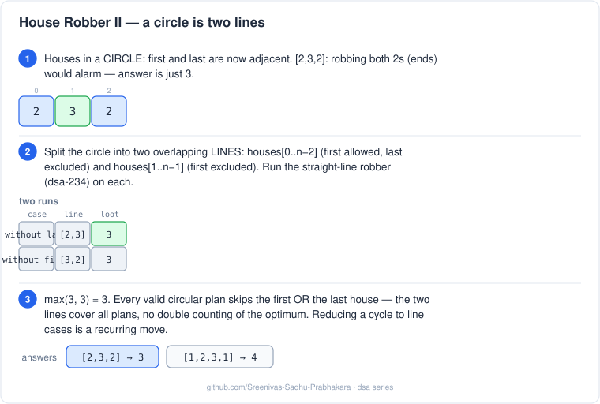

# House Robber II

> NeetCode 150 · 1-D DP · Blind 75 — break the circle by case analysis: any valid plan skips house 0 or skips the last, so run the linear robber twice. Go, stdlib only, tested.

## Problem

House Robber on a circle: the first and last houses are now adjacent, so they can't both be robbed.

## Approach

Circular constraints resist linear scans, but a two-case observation restores linearity: every legal plan either doesn't rob house 0 (then it's a *linear* problem on houses 1..n−1) or doesn't rob house n−1 (linear on 0..n−2). The two cases overlap (plans robbing neither endpoint appear in both) but cover everything, and max doesn't mind double counting. So: run dsa-234's two-state scan on both slices, take the better. The single-house circle is the one edge case the split mishandles (both slices go empty) — special-cased, and tested. "Cut the circle by casing on one element" generalizes to most circular-DP problems.

**Complexity:** O(n) time, O(1) space.

## Visual walkthrough

Read the picture top to bottom — each numbered frame is one moment of the algorithm
running on this repo's test example.

## Run

    go test ./...   # verify
    go run .        # demo

---

Part of a 275-repo DSA series in Go — Striver's SDE Sheet (dsa-001–191) plus the NeetCode 150 / Blind 75 additions (dsa-192–275), stdlib only, every solution tested. Browse: [`dsa-*` repos](https://github.com/Sreenivas-Sadhu-Prabhakara?tab=repositories&q=dsa-&type=source).
